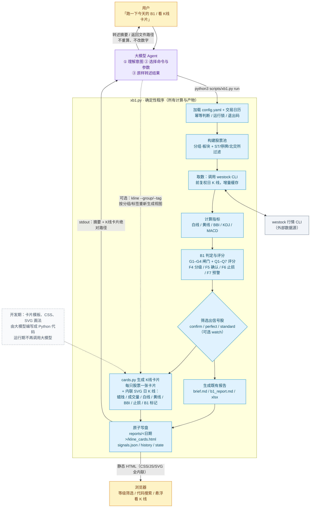

# K线卡片：实现流程与职责边界

> 结论：**运行时，从取数、判定信号、筛选股票到生成 HTML/SVG，全部由 `xb1.py` 的确定性程序完成；
> 大模型只负责“听懂需求 → 触发命令 → 转述结果”。** 大模型不参与任何数字计算、信号判定和画图。

## 职责划分

| 环节 | 实现方 | 说明 |
|---|---|---|
| 听懂“看 B1 卡片”并决定跑 `run` 还是 `html` | **大模型** | 只做意图理解与命令选择 |
| 选择 `--date / --group / --tag` 等参数 | **大模型** | 用户明确指定；不确定时先 `latest` |
| 交易日历、股票池、取数、缓存 | 程序 | `calendar.py` / `universe.py` / `fetcher.py` |
| 指标计算（白线/黄线/BBI/KDJ） | 程序 | `indicators.py`，纯函数 |
| B1 信号判定、评分、等级、止损、预警 | 程序 | `signals.py`，阈值全部来自 `config.yaml` |
| 决定哪些股票进入卡片页 | 程序 | 默认全部股票；`--signals` 时按 `cards.CARD_LEVELS` + `report.cards.include_watch` 过滤 |
| 计算图表坐标、画蜡烛/均线/成交量/止损线 | 程序 | `cards.py` 直接输出内联 SVG |
| 生成 HTML 页面、落盘、更新软链 | 程序 | `cards.write_cards()` + `atomic` |
| 摘要转述、给用户文件路径、补充一句评论 | **大模型** | 项目硬规则：数字只能原样转述，不能重算或补全 |
| 打开页面、点筛选按钮、悬浮看 K 线 | 用户 / 浏览器 | 纯前端交互，不再调用大模型 |

## 关键边界

- **大模型不接触原始 K 线**，不计算任何指标，不判断 B1，不参与评分。
- **K线卡片是静态文件**：生成后即使断网、关闭大模型，也能直接打开。
- **同一份信号只算一次**：`--group / --tag` 只是生成不同视图，不会重新判定信号。
- **可复现**：页面上的数字来自 `signals.json`，图表来自指标缓存/原始 K 线；同一日期、同一配置重跑结果一致。
